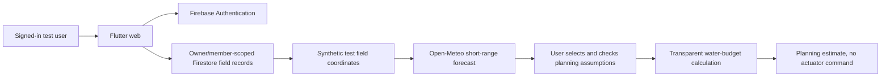

# Farmers Buddy — Youth4Climate evidence review

Reviewed 24 October 2026, Nairobi time. Application remains a draft; no submission was made.

## Official requirements

[ICPAC event page](https://www.icpac.net/events/youth4climate-services-innovation-hackathon/) lists a 6 November 2026 deadline and a demonstration requirement. The event runs 8–10 December in Nairobi. The applicant must confirm eligibility (age 18–35, IGAD nationality or residence, availability to attend).

The [official concept note](https://www.icpac.net/documents/1149/Concept_Note_Youth4Climate_Services_Innovation_Hackathon_2026.pdf) accepts an existing functional or pilot-stage climate solution and supporting prototype, screenshot, video or pilot evidence. No specific video duration, exclusive technology stack or public-repository requirement was found in these documents. The application form accepts up to five evidence files, each at most 100 MB. Four files (walkthrough and three screenshots) were attached and visible in the saved draft. Male and Kenya were selected at the user's explicit instruction. Other restored identity/eligibility details need final review.

## Verified in this session

* The deployed URL https://farmers-buddy-261012.web.app/ loaded and Firebase email/password sign-in succeeded using the user's authorized account. The existing record is explicitly labeled `TEST - synthetic Nairobi field`, with one hectare and sample maize data.
* Its live Open-Meteo forecast loaded seven daily rows, 24–30 October. The initial observation timestamp was `2026-10-24T07:45`; a later refresh during recording showed `2026-10-24T08:00`. Today's ET0 was 5.35 mm/day and forecast rainfall 0.6 mm. The application displayed `Forecast saved` after a snapshot save. No direct database inspection was performed.
* The water calculator returned **59,375 L/day** for 1 ha, ET0 5.35, crop coefficient 1, assumed effective rainfall 0.6 and efficiency 0.8. Increasing assumed effective rainfall to 10 returned **0 L/day**. Forecast rainfall was used as an explicit test assumption, not asserted to equal effective rainfall in a real field.
* The public repository is https://github.com/chrisndirangu54/Farmers-Buddy at base commit `6eaced8c2f589e2a3301a550987dabe2b66f533d`.
* A newer local working tree contains field mapping, an Open-Meteo weather client, water planning and related tests that are missing from that public base. It was copied into an isolated workspace for inspection and tests; original working files were not changed. The exact deployed build commit has not been established.
* `flutter pub get` completed. `flutter test test/workspace_test.dart test/workspace_crud_test.dart --reporter expanded` exited 0 with **10 tests passed**. These tests exercised boundary area and invalid polygons, rainfall/efficiency calculations, profit arithmetic, numeric validation, mobile navigation at three widths, desktop destinations and record validation/save/edit/delete with an in-memory store.

The automated tests use isolated local source and in-memory test doubles. Separately, the browser checks above demonstrate actual deployed weather retrieval and the application's save confirmation. Neither establishes real field use or agricultural outcomes. Source hashes are provided separately. The tests are not yet reproducible from the public repository alone because the newer working code is uncommitted.

## Existing functionality to demonstrate after sign-in

The inspected client calls Open-Meteo at a selected field's coordinates and requests seven days of temperature, precipitation and reference evapotranspiration. Its water calculation is:

`max(0, ET0_mm_day × crop_coefficient − effective_rain_mm_day) × area_ha × 10000 ÷ irrigation_efficiency`

Fresh screenshots accompany this report. The captioned, silent walkthrough records actual browser screenshots sampled during live interaction, retaining wall-clock timing and holding the last frame during capture gaps. It shows the water calculation, rainfall-to-zero case, synthetic field label, genuine weather retrieval and forecast-save confirmation. The recording provenance file documents the sampling method and timing. It is software demonstration evidence, not a simulated product mockup or a real-farm pilot.

## Remaining work before submission

1. Review the screenshots, recording and provenance. The live sign-in, forecast, save confirmation and rainfall-to-zero checks are complete. Device actuation, farm trials and field outcomes were not tested.
2. The 99-second captioned walkthrough and three screenshots are attached to the saved draft. The concise recording length is a preparation choice, not an official duration rule found in the reviewed materials.
3. Reconcile the newer local source with GitHub in a separately reviewed code PR, including required assets/configuration instructions. Do not overwrite or silently discard existing uncommitted work.
4. Confirm the remaining profile information in the restored form and upload genuine evidence. Obtain final application submission approval.

No farm ownership, field trial, customer adoption, water savings, sensor installation, seasonal forecast or ICPAC integration is claimed.
